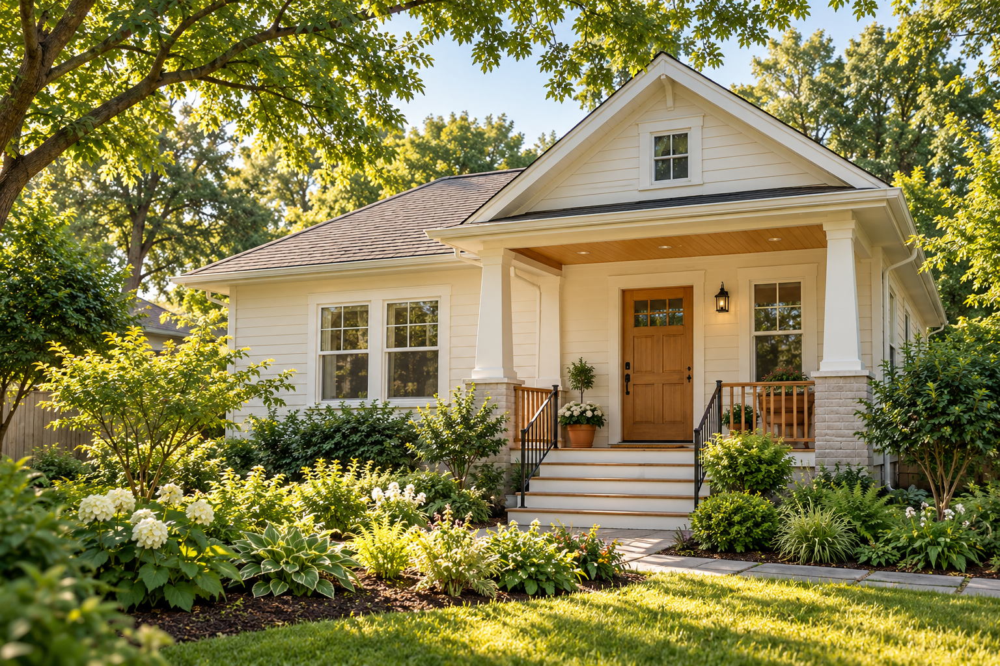

# CrawlAware™

**Peace of mind, from the ground up.**

CrawlAware brings together environmental sensing, ventilation control and fan monitoring to help homeowners and installers understand and manage conditions beneath a home.

## Measure. Compare. Ventilate.

- **Measure conditions:** Monitor temperature and humidity inside and outside the crawlspace.
- **Compare drying potential:** Use indoor and outdoor dew points to identify when ventilation can offer a drying benefit.
- **Coordinate ventilation:** Control intake, exhaust and circulation fans through automatic, manual and standby modes.
- **Monitor fan operation:** Use RPM feedback and circuit status to help identify stopped, slow or unresponsive equipment.
- **See the system clearly:** View readings, settings, device status and troubleshooting information through the CrawlAware Controller’s local browser dashboard.

## Our approach

**Local control.** Core monitoring and control run on the CrawlAware Controller, with a dashboard accessible on the local network.

**Configurable hardware.** Fan circuits can be configured for one- or two-fan assemblies.

**Useful feedback.** Environmental readings and equipment status help explain what the system is doing and why.
